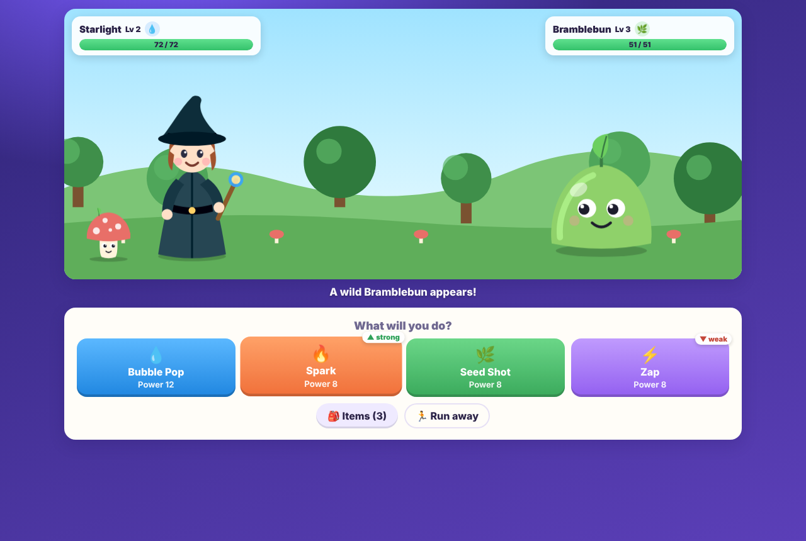
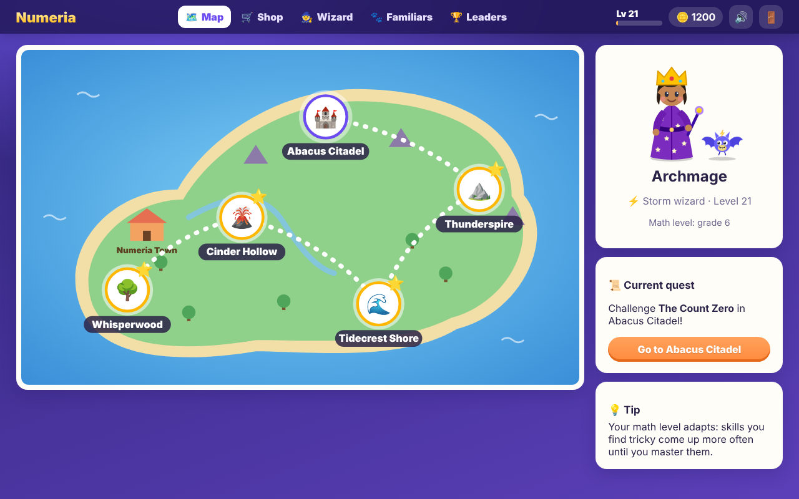

# Numeria for YunoHost

*A self-hosted math adventure RPG for kids, packaged for [YunoHost](https://yunohost.org).*



## Overview

Numeria is a turn-based fantasy adventure where every spell is cast by solving a math problem. Children create a wizard, explore five lands, befriend monsters and defeat guardians, while the game quietly adapts the questions (grades 1 to 8) to what each child needs to practise.

See [doc/DESCRIPTION.md](doc/DESCRIPTION.md) for the full feature list and [doc/ADMIN.md](doc/ADMIN.md) for administration notes.

| World map | Teacher dashboard |
|---|---|
|  |  |

**Shipped version:** 1.0.0~ynh1

## Installation

From the YunoHost admin panel (*Applications > Install > Install a custom app*), paste the URL of this repository, or from the command line:

```bash
sudo yunohost app install https://github.com/gzplaz/prodigy_ynh
```

During installation you choose:

- the domain and path (default `/numeria`),
- who can play (`visitors` by default, so children don't need a YunoHost account),
- who can open the teacher dashboard (`admins` by default).

## How it works

| Part | Technology |
|---|---|
| Game client | Plain HTML, CSS and JavaScript modules, all art is inline SVG (no build step, no external resources) |
| Server | `sources/server.py`, Python 3 standard library only (no `pip install`) |
| Storage | SQLite database in the app's data directory |
| Web server | NGINX reverse proxy, YunoHost SSO protects `/teacher` |

Packaging uses YunoHost packaging v2 and helpers 2.1 (YunoHost 12 or newer).

## Development

Run the game locally (no YunoHost needed):

```bash
python3 sources/server.py --port 8095 --db /tmp/numeria.db --teacher-open
```

Then open <http://127.0.0.1:8095/>. The `--teacher-open` flag makes the teacher dashboard (`/teacher/`) reachable without YunoHost SSO. Never use it in production.

Tests:

```bash
python3 dev/test_server.py
```

```bash
node dev/test_math.mjs
```

`test_server.py` covers the API, sessions, validation, CSRF protection, the teacher endpoints and path traversal. `test_math.mjs` fuzzes every question generator (thousands of questions per difficulty tier) and checks that answers are correct, choices are unique and the text is clean.

## License

MIT, see [LICENSE](LICENSE).
